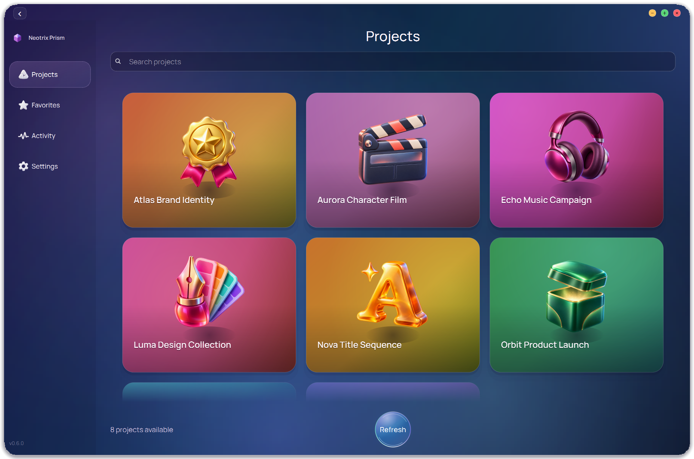
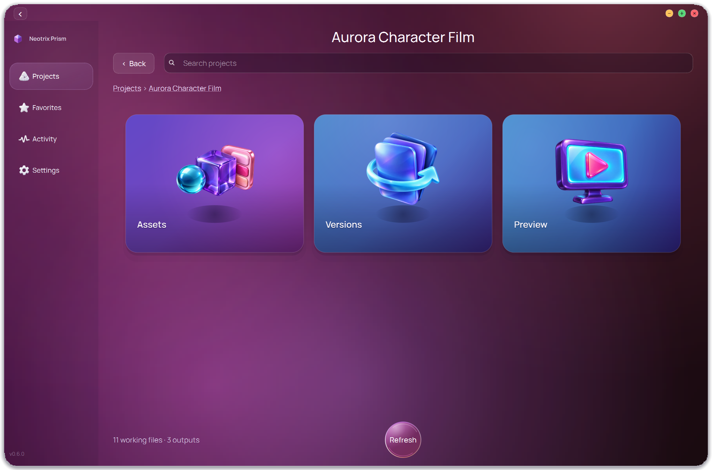
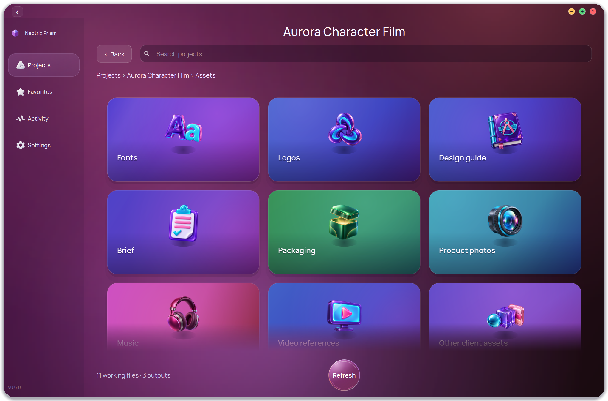
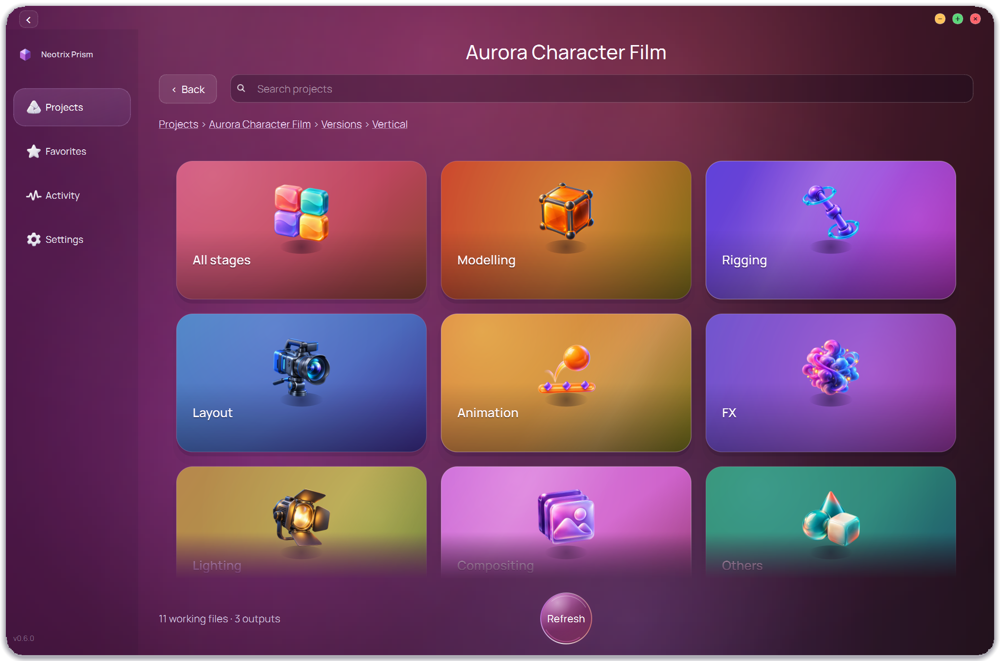
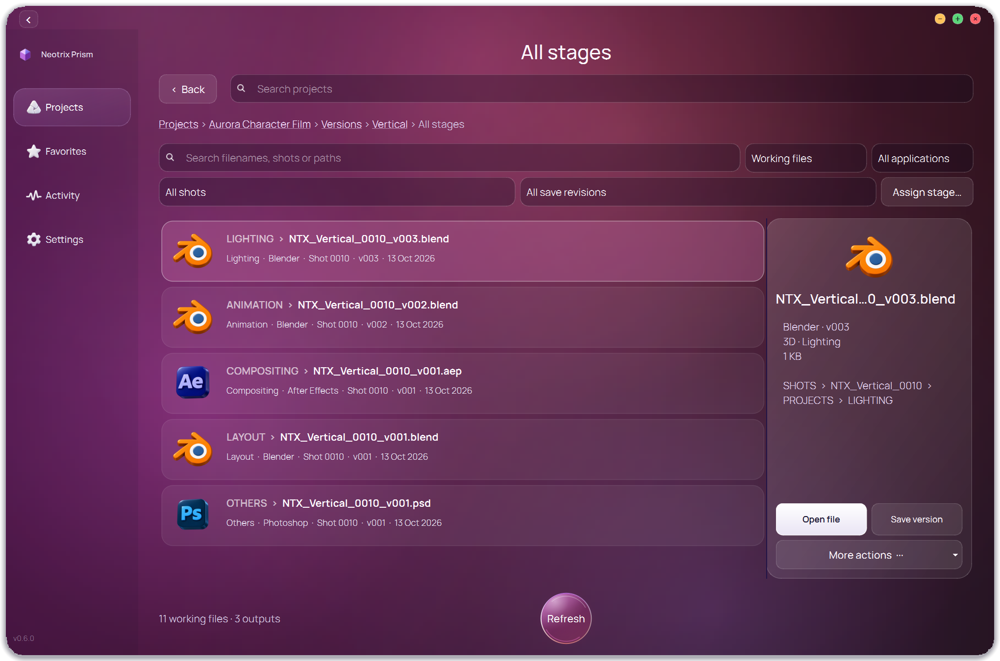
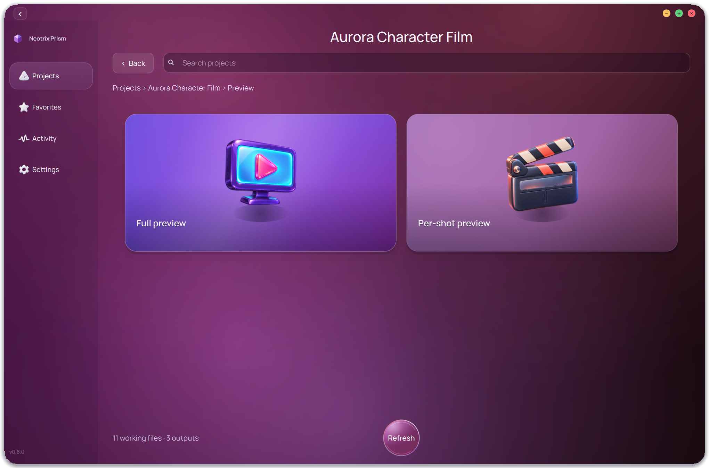
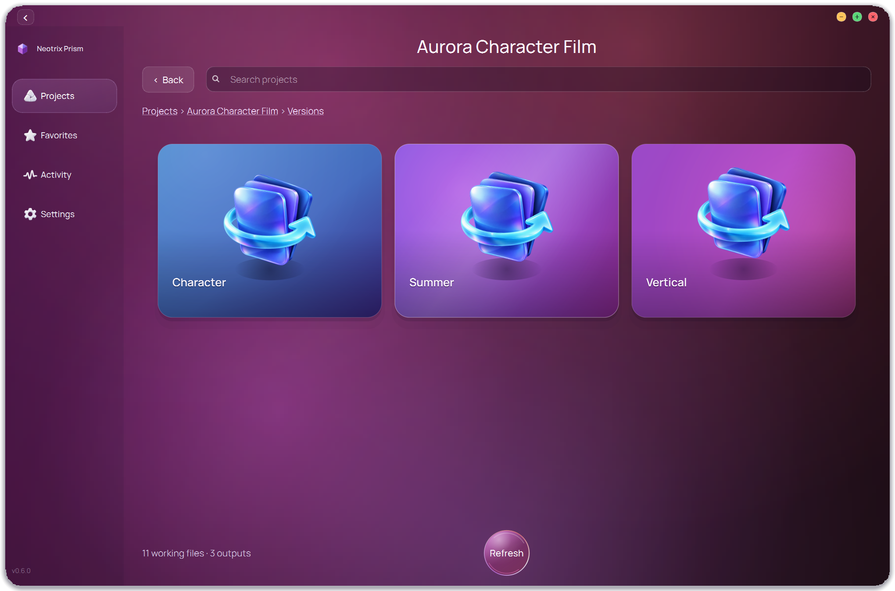
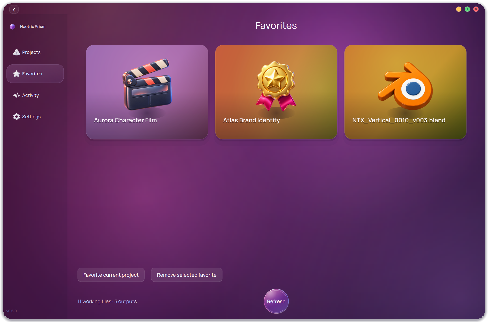
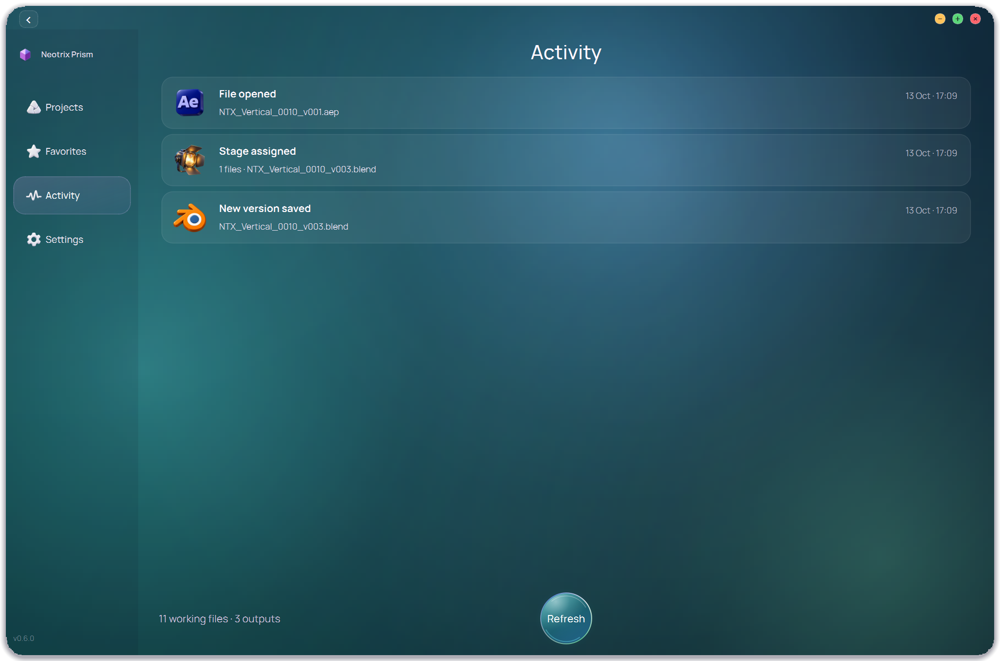
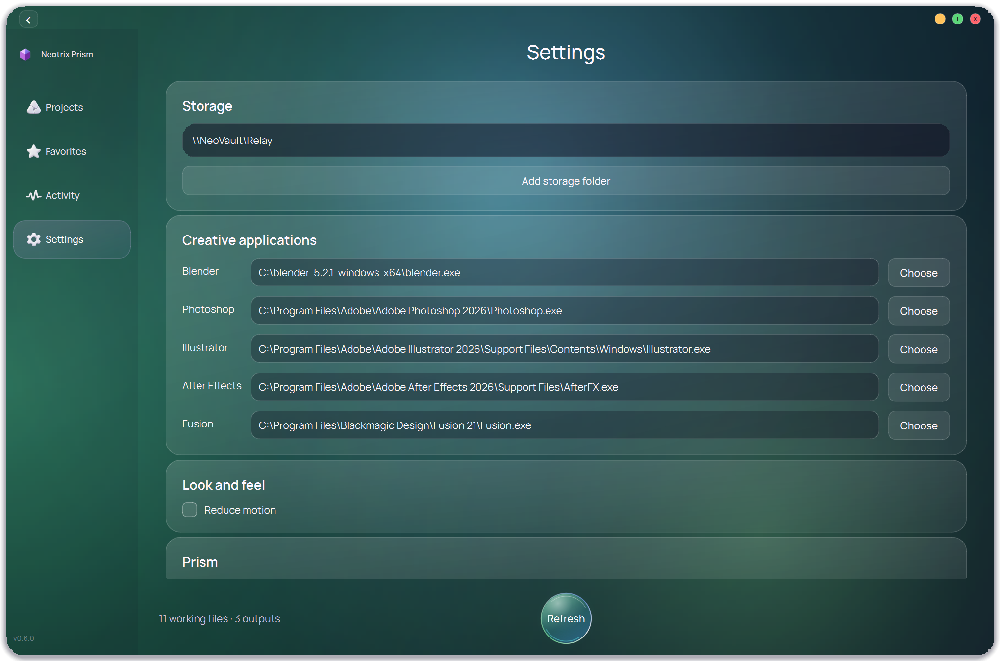

# Neotrix Prism

A portable Windows workspace for creative projects, built on the open-source
[Prism Pipeline](https://github.com/PrismPipeline/Prism). Browse existing folders,
find client assets, open creative documents, save new working versions and review
full-video or per-shot previews without reorganizing production files.

**[Download the Windows 0.6.0 preview](https://github.com/neotrixproduction/neotrix-prism/releases/tag/v0.6.0-preview)** ·
[Setup guide](START_HERE.md)

## Browse a project

Opening a project presents **Assets | Versions / Working files | Preview**.

- **Assets:** client fonts, logos, design guides, briefs, packaging, product photos,
  music and video references. Production assets remain in Working files.
- **Versions / Working files:** choose a named campaign version when present,
  then a production stage and its files. Projects without named versions go
  directly to stages.
- **Preview:** separate Full preview and Per-shot preview collections, showing
  MP4 and MOV videos. Image sequences and EXRs are excluded from this section.

### Client assets

### Production stages

Browse modelling, rigging, layout, animation, FX, lighting, compositing and other
work. Shared stage assignments support single-file and multi-selection changes;
explicit assignments override folder inference without moving files.

### Working files

Filter by application, shot and save revision. File rows show stage, application,
revision and modification date, with details and actions beside the selection.
Open files, choose another application, reveal folders, copy paths or add favorites.
Blender, Photoshop and After Effects adapters can save the current document,
including unsaved edits, as a new working version.

### Video previews

More current screenshots: versions, favorites, activity and settings

### Named versions

### Favorites

### Activity

### Settings

These are current **0.6.0 native Qt screenshots**, captured at 150% Windows
scaling with fictional demo projects. No production documents or credentials
are included. [Capture details and reproduction](docs/screenshots/0.6/README.md).

## Run on Windows

1. Download the ZIP from the [0.6.0 preview release](https://github.com/neotrixproduction/neotrix-prism/releases/tag/v0.6.0-preview).
2. Extract the **whole ZIP** to a stable local folder.
3. Double-click **Neotrix Prism.exe**. Keep the runtime and assets beside it.
4. Open Settings to check storage roots and creative application paths.

Use **64-bit Windows 10 or 11**. Python, Qt, Manrope and runtime DLLs are included;
no separate Python, Qt or font installation is needed. Creative applications must
be installed separately to open their documents. Video files use the PC's
associated player.

The default project root is `\\NeoVault\Relay`. Other PCs need network access and
their own share permissions; a mapped drive is not required. Additional roots
can be added in Settings. Existing folders are scanned in place and are not
automatically converted into Prism-managed projects.

Optionally run **Create Desktop Shortcut.cmd** for an app shortcut. Run
**Install Integrations.cmd** for the separate Blender and Adobe panels.
Photoshop's docked UXP panel requires Adobe's UXP installer; a companion JSX can
open the Qt workspace when that installer is unavailable. If the portable folder
moves, rerun the integration installer and shortcut creator.

See [Start here](START_HERE.md) for another PC and [Setup](docs/SETUP.md) for
project icons, shared stage labels, integrations and version saving.

## Relay V3 template and examples

The [Relay commercial production template V3](examples/relay-template-v3/README.md)
includes the complete empty folder structure, interactive foldering guide,
folder instructions, project icon placeholder and concrete naming examples.
[Download its ZIP](examples/relay-template-v3/COMMERCIAL_ADS_TEMPLATE_V3.zip)
or [read the folder map](examples/relay-template-v3/FOLDER_MAP.md) on GitHub.
Copy the template for a new project; it contains no production documents.

## Interface and storage

The dark interface combines rounded gradient cards, generated dimensional
artwork, Manrope typography and a collapsible sidebar. Retargetable spring
motion, floating artwork, zoom-through navigation and a glass Refresh control
share one motion system. Refresh is available on every page; reduced motion is
available in Settings. Text stays at native size during artwork animation.

Custom project artwork loads asynchronously from `_TOOLS/icon`, with local
caching and bundled fallbacks. Preferences, caches and activity are stored per
user. Shared stage assignments have concurrent-edit protection; cached browsing
remains available offline, while shared writes require connected writable storage.

- [Motion and visual reference](docs/MOTION.md)
- [Refresh animation handoff](docs/REFRESH_ANIMATION.md)
- [Application icon artwork and generation sources](assets/app-icons/SOURCE.json)

## Preview status

Real open/save/reopen checks passed for Blender, Photoshop and After Effects;
file-opening checks passed for Illustrator and standalone Fusion. Desktop scaling
was reviewed at 100%, 150% and 200%.

Photoshop UXP installation, a clean physical second-PC check and the true
two-workstation pilot remain pending. The preview executable is unsigned.
Native advanced Prism tools retain their established layouts with the shared
Neotrix theme. See [Validation](VALIDATION.md) and the
[functional audit](docs/FUNCTIONAL_AUDIT.md) for evidence and limits.

## Source and maintenance

Forked from [PrismPipeline/Prism](https://github.com/PrismPipeline/Prism), pinned to
v2.1.3, `fd440de6747b7e62e2ba8cb675028e7adbbce1e3`. Upstream history and license notices
are retained. No commercial Prism plugins are included.

The independent Workflows feature is removed. Existing shared graph documents
are preserved, and native Prism production tools remain available in Settings.
Automatic upstream replacement is disabled; upgrades are deliberate merges
followed by validation.

- [Development](docs/DEVELOPMENT.md)
- [Upstream changes](UPSTREAM.md)
- [Original upstream README](docs/UPSTREAM_README.md)

Neotrix additions are LGPL-3.0-or-later. Existing components retain their
applicable upstream licenses. Runtime third-party licenses are in the Windows
package. User preferences, real production files and credentials are excluded
from this repository.
