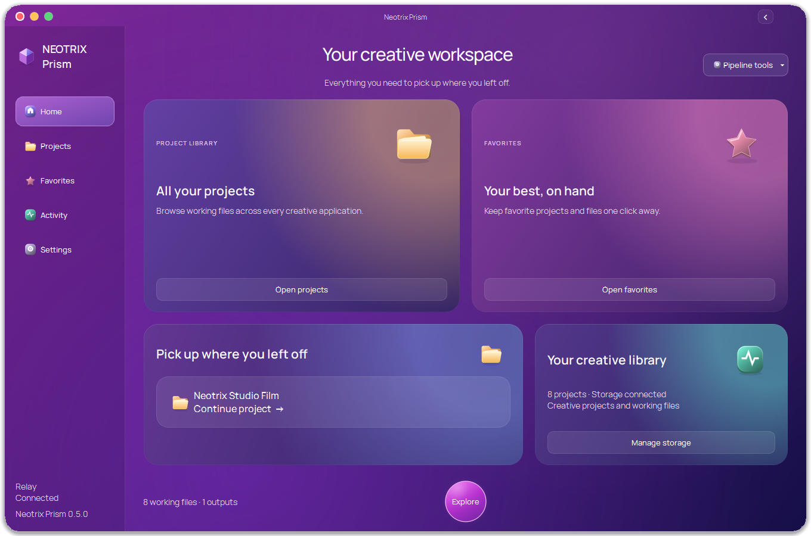
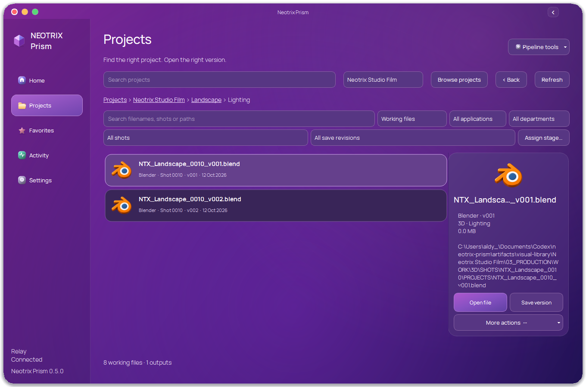
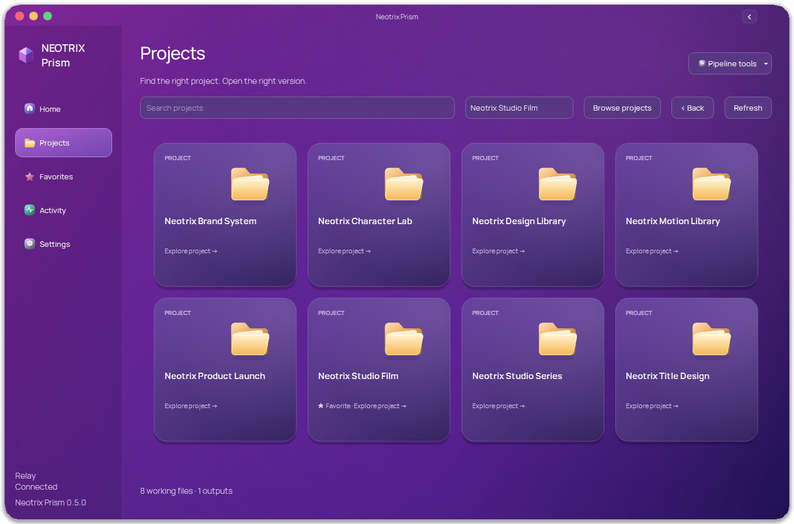
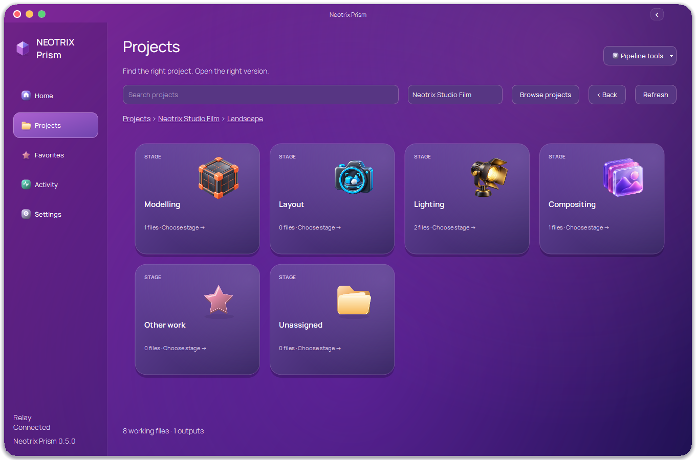

# Neotrix Prism

A Windows creative-project workspace built on the open-source Prism Pipeline.
Browse existing project folders across Blender, Illustrator, Photoshop, After
Effects and Fusion, save working versions, and organize files with shared stage labels.

The interface uses a continuous purple-to-indigo background, luminous tinted
tiles, dimensional original icons and choreographed motion inspired by the current
CleanMyMac design. Both appearances use colored surfaces; the dark variant
reduces brightness. Sidebar, file lists, settings and native Prism dialogs share
the same palette. Projects use uniformly spaced cards, followed by named-version and stage cards,
then a native-resolution file list. Scroll, drag or use arrow keys to browse. Scrollbars are hidden across Neotrix surfaces.

The rounded Windows shell includes custom window controls, draggable caption,
edge resizing and a collapsible animated sidebar. The home uses
staggered card/icon entrances, spring-driven tile expansion, pointer parallax,
reactive lighting, highlight sweeps and click ripples. Opening a home tile reveals
its destination through a growing rounded surface; sidebar navigation uses
directional depth. A morphing circular control shows task progress. Reduced motion
disables the timelines, including an in-flight page transition.

Manrope provides heading and body typography with distinct sizes and weights.
The OFL font files and license are bundled; no font installation is required.
See [Motion and visual reference](docs/MOTION.md).

Creative applications use thick 3D artwork based on their actual installed app
icons. The transparent assets and complete generation prompts are in
[assets/app-icons](assets/app-icons/SOURCE.json). These are rendered PNG assets,
not mesh models. Existing preview images are used without launching applications.

[Watch the real Qt motion preview](docs/screenshots/motion.mp4).

## Run on Windows

Download the Windows preview package from this repository's Releases, extract it
to a stable folder, and double-click **Launch Neotrix Prism.cmd**. Python and Qt
are included; there is no separate Python installation.

Open Settings to check storage roots and application paths. Relay is the default
shared project library. Projects are scanned in place; existing production
folders are not migrated or renamed.

Run **Install Integrations.cmd** for the separate Blender and Adobe integrations.
Photoshop's docked UXP panel requires Adobe's UXP installer; a companion JSX can
open the Qt workspace when that installer is unavailable.

See [Setup](docs/SETUP.md) for project icons, stage labels, opening files and version saving.

## Included

- Uniform project cards, named campaign versions, 3D stage cards and a multi-selection file list.
- Per-project artwork loaded asynchronously from `_TOOLS/icon`, with cached fallback.
- Shared stage labels with concurrent-edit protection and offline browsing.
- Application, department, shot and save-revision filters; working files and outputs.
- Open, Open With, Reveal Folder, Copy Path, favorites and recent projects.
- In-memory version saves through Blender, Photoshop and After Effects adapters.
- Light/dark appearance, keyboard focus and a reduced-motion setting.
- Retained Prism-managed project and production services with the Neotrix theme.

The screenshots use fictional indexing fixtures. They are screenshots of the
native Qt app, not browser mockups.

## Preview status

Real open/save/reopen checks passed for Blender, Photoshop and After Effects;
file-opening checks passed for Illustrator and Fusion. Desktop scaling was
reviewed at 100%, 150% and 200%.

The Photoshop UXP installation and the true two-workstation pilot are still
pending. Native advanced Prism tools keep their established layouts with the
shared Neotrix theme. See [Validation](VALIDATION.md) for evidence and limits.

## Source and maintenance

Forked from [PrismPipeline/Prism](https://github.com/PrismPipeline/Prism), pinned to
v2.1.3, fd440de6747b7e62e2ba8cb675028e7adbbce1e3. Upstream history and license notices
are retained. No commercial Prism plugins are included.

The independent Workflows feature is removed from this release. Existing shared graph documents are preserved.
Automatic upstream replacement is disabled; upgrades are merged and tested.

- [Development](docs/DEVELOPMENT.md)
- [Upstream changes](UPSTREAM.md)
- [Original upstream README](docs/UPSTREAM_README.md)

Neotrix additions are LGPL-3.0-or-later. Existing components retain their
applicable upstream licenses. Runtime third-party licenses are in the Windows
package. User preferences, real production files and credentials are excluded
from this repository.
